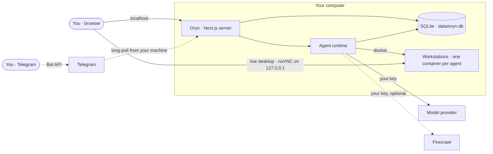

<p align="center">
  
</p>

<h1 align="center">Oryn</h1>

<p align="center">
  <strong>The open-source Muse, Grok Bot &amp; Dots — on your machine, with your keys.</strong><br>
  AI agents that do real work on their <em>own</em> sandboxed Linux desktops — never on yours.<br>
  Your data stays on your disk. Bring any model. Text your agents from anywhere.
</p>

<p align="center">
  <a href="https://github.com/SouravBeraAkaSpeed/oryn/actions/workflows/ci.yml"></a>
  <a href="LICENSE"></a>
  <a href="https://github.com/SouravBeraAkaSpeed/oryn/stargazers"></a>
  
  <a href="CONTRIBUTING.md"></a>
</p>

<p align="center">
  <a href="#quick-start">Quick start</a> ·
  <a href="#why-oryn">Why Oryn</a> ·
  <a href="#how-it-compares">Compare</a> ·
  <a href="docs/telegram.md">Telegram</a> ·
  <a href="docs/architecture.md">Architecture</a> ·
  <a href="CONTRIBUTING.md">Contribute</a>
</p>

<p align="center">
  
</p>

---

This year every major lab shipped a personal agent that works on a cloud machine for you — **Muse** from Meta, **Grok Bot** from xAI, **Dots** from OpenAI. They're impressive. They're also closed, gated behind subscriptions, and they run on someone else's servers with your conversations, your logins and — when they shop for you — your payment details.

**Oryn is the same idea as one open-source app you run yourself.** Clone it, add your API keys, and you have a team of agents that each own a sandboxed Linux workstation, remember what matters, browse and research the web, write and run code, and hand work to one another. Nothing is stored anywhere but your computer, and you can message them from your phone.

**One command sets everything up** — Git, Node.js, Docker, the agents' desktop — and starts Oryn:

```bash
# macOS / Linux
curl -fsSL https://raw.githubusercontent.com/SouravBeraAkaSpeed/oryn/main/setup.sh | bash
```

```powershell
# Windows (PowerShell)
irm https://raw.githubusercontent.com/SouravBeraAkaSpeed/oryn/main/setup.ps1 | iex
```

**Have a coding agent?** Paste [one prompt](#set-up-with-your-coding-agent) into Claude Code, Codex or Cursor — it installs everything, asks you for your keys and starts Oryn.

## Why Oryn

**🔒 Private by design.** No account, no sign-up, no payment details — ever. Conversations, memory, settings and keys live in a single SQLite file on your disk. Even the agents' machines run on your computer. The only things that leave it are the calls you configure (your model provider, plus Firecrawl or Telegram if you turn them on). Run a local model through Ollama and not even your prompts leave.

**🖥️ It never touches your computer.** Every agent works on its **own** sandboxed Linux desktop — a Docker container with a shell, files and a real Chromium — completely separate from your system. It doesn't move your mouse, take over your screen or read your files. Watch a movie, play a game or keep coding while it works. Or watch it work, live, and take the wheel whenever you want.

**📱 Control it from anywhere.** Pair Telegram in two minutes — scan a QR code and you're done. No public URL, no tunnel, no port forwarding: Oryn polls Telegram from your machine. Your agents answer from wherever you are, with live progress and screenshots.

**🧠 Any model, your keys.** OpenAI, Anthropic, Google, xAI, Groq, Mistral, DeepSeek, OpenRouter, Ollama, LM Studio, or any OpenAI-compatible endpoint. Pick a model per agent. No subscription — you pay providers directly for what you use.

**🗑️ Disposable machines.** Reset an agent and its container is destroyed. Delete it and it's gone. Turn on auto-delete and workstations vanish after every session — while the agent's memory stays safe on your disk.

**👥 Agents that work as a team.** Put several agents in a squad. Ask any of them; they delegate to whoever fits the job — each on its own model and its own machine.

## How it compares

|  | **Oryn** | Hosted agents<br><sub>Muse · Grok Bot · Dots</sub> | Local computer-use agents<br><sub>e.g. OpenClaw</sub> |
| --- | --- | --- | --- |
| Source | ✅ Open source (MIT) | ❌ Closed | ✅ Open source |
| Where the agent works | Its own sandboxed desktop (Docker, on your machine) | Vendor's cloud computer | Your computer |
| Uses your mouse, screen or files | **Never** | No — vendor cloud | Yes — shell, files and apps on your machine |
| Browses from | **Your own connection** | Vendor data centers | Your own connection |
| Where your data lives | **Your disk** | Vendor's servers | Your disk |
| Account required | **No** | Yes | No |
| Card on file to shop for you | **Never** — you pay by taking control | Supported by some | Depends on setup |
| Models | **Any — 11 providers, incl. local** | The vendor's own | Many |
| Remote control | Telegram | Vendor apps & integrations | Chat apps |
| Price | **Free** + pay-as-you-go APIs | Paid plans / subscriptions | Free + APIs |

<sub>Based on public launch coverage as of October 2026. These products move fast — corrections welcome.</sub>

## Features

<table>
<tr>
<td width="50%" valign="top">

**Agents with a job**<br>
Name, role, standing orders, and a model of their own. Start from templates or write your own.

**A workstation per agent**<br>
A Docker container with a shell, a persistent home folder and a 1280×800 desktop with Chromium — created on first use, stopped when idle, never touching your own files.

**Live desktop, take over any time**<br>
Watch the agent click and type in real time. Hit **Take over** and it pauses; hand it back with a note and it picks up from what you did.

</td>
<td width="50%" valign="top">

**Long-term memory**<br>
Agents save what matters about you and your work; every thread sees it. Inspect, add or delete notes any time.

**Web research**<br>
Search and clean page reading through Firecrawl, with cited sources.

**Durable turns**<br>
Close the tab mid-task — the agent keeps going. Reopen and you're re-attached to the live stream. Stop it any time.

**It tells you when it's done**<br>
A chime and a desktop notification when an agent finishes, fails or needs you — and a Telegram message when you're away from the computer.

</td>
</tr>
</table>

<p align="center">
  
  
</p>
<p align="center">
  
  
</p>

## What can it do?

Anything that can be done with a terminal, a browser and a desktop — while you get on with your day:

- **Build and debug** — clone a repo, install, run the tests, fix what fails, show you the diff.
- **Research** — search, read primary sources, and come back with a cited summary.
- **Write** — launch posts, docs, reports, saved as files on its workstation.
- **Work the web** — fill forms, compare options, prepare a booking or an order. When a site needs your login, a payment or a CAPTCHA, the agent **stops and hands you the screen**; your card never touches Oryn.
- **Run as a team** — ask a squad, and the right specialist takes it.

Agents ask when they need a decision, confirm before anything irreversible, and remember what you tell them.

### You can always take the wheel

- **Take over** — one click pauses the agent and gives you its desktop. Type, click, fix what it got wrong. **Hand back** with an optional note ("I picked the 6:40 flight") and the agent looks at the screen and continues from there.
- **Hand-offs** — at a login, a payment page, a one-time code or a CAPTCHA, the agent stops by itself and tells you exactly where it is and what's left. The take-over view opens on your screen, and if Telegram is paired you get a message with a **live link to the desktop that works from your phone**. Pay on the agent's screen, reply "done", and it wraps up.
- **Browses like a person** — agents open a site's home page and use its own search forms and filters instead of guessing deep links, so you can follow along and step in at any point.

> **Real browsing, from your own connection.** Agents' machines run on your computer, so sites see an ordinary home connection rather than a data center — no blocked sites, far fewer CAPTCHAs.

## Quick start

**You need:** a computer with about 4 GB of free disk, and an API key for at least one model provider. The setup installs everything else. [Firecrawl](https://www.firecrawl.dev) (fast web search) is optional.

### 1 · Set up — one command

| Your system | Run this in a terminal |
| --- | --- |
| **macOS / Linux** | `curl -fsSL https://raw.githubusercontent.com/SouravBeraAkaSpeed/oryn/main/setup.sh \| bash` |
| **Windows** (PowerShell) | `irm https://raw.githubusercontent.com/SouravBeraAkaSpeed/oryn/main/setup.ps1 \| iex` |

Already cloned the repo? Run `./setup.sh` on macOS/Linux, or double-click **`setup.cmd`** on Windows.

The setup asks once, then does the rest:

1. Installs what's missing — **Git**, **Node.js**, and **Docker** (Docker Desktop through `winget` on Windows or Homebrew on macOS; Docker Engine through `get.docker.com` on Linux).
2. Clones Oryn into `./oryn` and installs its packages.
3. Starts Docker and builds the agents' desktop image — a few minutes, once.
4. Creates `.env` and starts Oryn at **<http://127.0.0.1:6796>**.

> The first time, Docker Desktop may ask you to accept its terms, and on Windows it can ask for a restart to turn on WSL 2. Afterwards run the setup again; it skips everything that's already done.

### Set up with your coding agent

Using Claude Code, Codex, Cursor or another coding agent? Paste this prompt into it. It installs everything, asks you for your keys and starts Oryn:

```text
Install and start Oryn for me — an open-source app that runs AI agents on my own computer: https://github.com/SouravBeraAkaSpeed/oryn

1. From my home folder, run Oryn's setup without prompts. It clones Oryn into ./oryn (or reuses it), installs Git, Node.js and Docker if they're missing, installs the packages and builds the agents' desktop image, which takes several minutes the first time — let it finish:
   - macOS / Linux:  curl -fsSL https://raw.githubusercontent.com/SouravBeraAkaSpeed/oryn/main/setup.sh | ORYN_YES=1 ORYN_NO_START=1 bash
   - Windows (PowerShell):  $env:ORYN_YES="1"; $env:ORYN_NO_START="1"; irm https://raw.githubusercontent.com/SouravBeraAkaSpeed/oryn/main/setup.ps1 | iex
   (If you'd rather not pipe a script, clone the repo and run ./setup.sh or .\setup.ps1 inside it with the same two variables.)
   - If it stops and shows a command that needs my password, show me that command, wait for me to run it in my own terminal, then run the setup again.
   - If Docker Desktop was just installed or isn't running, ask me to open it and accept its terms (Windows may also ask for a restart). Wait until `docker info` works, then run the setup again.
   - Node.js may have been installed into ~/.oryn/node/bin; add that to PATH in your shell if `node` isn't found.

2. Ask me for my keys. Explain each in one sentence with where to get it, and let me skip the optional ones:
   - Required, at least one model provider: OpenAI (OPENAI_API_KEY, platform.openai.com/api-keys), Anthropic (ANTHROPIC_API_KEY, console.anthropic.com), Google Gemini (GOOGLE_GENERATIVE_AI_API_KEY, aistudio.google.com/apikey) — or any other provider listed in .env.example, including a local Ollama or LM Studio.
   - Optional: FIRECRAWL_API_KEY (firecrawl.dev) for fast web search.
   - Optional: TELEGRAM_BOT_TOKEN to talk to my agents from my phone. Tell me how to get it: in Telegram, message @BotFather, send /newbot, choose a name and a username ending in "bot", and copy the token it replies with.
   Put what I give you into the matching lines of oryn/.env. Never repeat the keys back to me, log them or commit .env.

3. Start Oryn with `npm run dev` inside the oryn folder, in the background. Wait until http://127.0.0.1:6796 responds, then open it in my browser.

4. Finish with a short summary: what got installed, which keys are set, how to start Oryn next time (cd oryn && npm run dev), and — if I added a Telegram token — that I should open Settings → Remote access in Oryn and scan the QR code with my phone to pair it.
```

<details>
<summary>Prefer to do it by hand?</summary>

Install [Node.js 20.9+](https://nodejs.org) and [Docker](https://docs.docker.com/get-started/get-docker/), then:

```bash
git clone https://github.com/SouravBeraAkaSpeed/oryn.git
cd oryn
npm install
npm run setup     # checks Docker, builds the agents' desktop image, creates .env
npm run dev
```

</details>

### 2 · Add a key

Paste a model provider key into **Settings** in the app — or put it in `.env`:

```bash
OPENAI_API_KEY=sk-...          # or any other provider
FIRECRAWL_API_KEY=fc-...       # optional: web search & reading
```

### 3 · Start it any time

```bash
cd oryn
npm run dev                    # or: npm run build && npm start
```

Open **<http://127.0.0.1:6796>** and deploy your first agent. *(6796 spells O-R-Y-N on a phone keypad.)* Prefer containers all the way down? `docker compose up -d` runs Oryn itself in Docker too.

Click **alerts** in the status bar once to allow desktop notifications: you'll hear a chime and get a notification whenever an agent finishes, fails or needs you — even with Oryn in the background.

## Remote control from Telegram


1. In Telegram, message **@BotFather** → `/newbot` → copy the token.
2. Paste it in **Settings → Remote access**.
3. Scan the QR code with your phone and tap **Start**.

Done — only your account can use the bot.

```
/agents   pick an agent or squad      /new     start a fresh thread
/stop     interrupt the agent         /status  what's running
```

When an agent needs you — a payment, a login, a code — the bot pings you with a live link to the agent's desktop. Finish the step from your phone, reply "done", and the agent carries on. Longer tasks you started at your computer report back here too when they finish, so you can walk away.

Full walkthrough: **[docs/telegram.md](docs/telegram.md)**.

## Architecture



One process, one file. The Next.js server serves the UI, runs agent turns in-process through the [AI SDK](https://ai-sdk.dev), and owns the SQLite database — no queue, no worker, no backend of ours. Details in **[docs/architecture.md](docs/architecture.md)**.

| Path | What lives there |
| --- | --- |
| `lib/agent/` | Runtime, tool belt, instruction builder |
| `lib/providers/` | Provider catalog, model factory, live model discovery |
| `lib/telegram/` | Bot API client, formatter and the bridge |
| `lib/workstation.ts`, `lib/docker.ts`, `workstation/` | Agents' machines: containers, desktop control and the image they run |
| `lib/web.ts` | Firecrawl |
| `db/` | Drizzle schema and migrations |
| `app/`, `components/` | The interface |

## Configuration

Every setting can come from `.env` **or** from **Settings** in the app. Values saved in the app win, are stored only in `data/oryn.db`, and are shown back to the browser masked. The annotated list is in [`.env.example`](.env.example); providers are covered in [docs/providers.md](docs/providers.md).

| Variable | Purpose |
| --- | --- |
| `OPENAI_API_KEY`, `ANTHROPIC_API_KEY`, `GOOGLE_GENERATIVE_AI_API_KEY`, `XAI_API_KEY`, `GROQ_API_KEY`, `MISTRAL_API_KEY`, `DEEPSEEK_API_KEY`, `OPENROUTER_API_KEY` | Hosted model providers |
| `OLLAMA_BASE_URL`, `LMSTUDIO_BASE_URL`, `CUSTOM_BASE_URL` | Local runtimes and any OpenAI-compatible API |
| `ORYN_DEFAULT_MODEL`, `ORYN_MAX_STEPS` | Default `provider/model`, max tool calls per turn |
| `ORYN_WORKSTATION_CPUS`, `ORYN_WORKSTATION_MEMORY_GB` | Limits for each agent's machine (default 2 CPUs, 4 GB) |
| `ORYN_WORKSTATION_AUTO_STOP_MINUTES`, `ORYN_WORKSTATION_AUTO_DELETE_MINUTES` | Idle stop; disposable machines |
| `ORYN_PHONE_TAKEOVER` | `off` leaves the phone link out of Telegram hand-offs |
| `FIRECRAWL_API_KEY` | Web search and reading |
| `TELEGRAM_BOT_TOKEN`, `TELEGRAM_OWNER_ID` | Remote access |
| `ORYN_TELEGRAM_NOTIFY` | Telegram notice when a task finishes: `long` (a minute or more, default), `all` or `off` |
| `ORYN_DATA_DIR`, `ORYN_ALLOWED_HOSTS` | Data location; extra hostnames behind your own proxy |
| `ORYN_URL` | Where you open Oryn, for links in Telegram hand-offs |

## Security & privacy

Oryn has no user accounts, so it's built never to be reachable by anyone but you:

- Binds to **127.0.0.1** only, and refuses any request whose `Host` or `Origin` isn't loopback — which also blocks DNS-rebinding attacks from web pages you visit.
- API keys never reach the browser; the UI only sees masked values, and keys are kept out of logs.
- Telegram answers exactly **one** paired account; pairing codes are single-use and rotate after wrong guesses.
- Agents execute only inside their own containers — never on your desktop or in your files — and never hold your passwords or cards. Their browsers have password saving and card autofill switched off.
- Each live desktop is published on 127.0.0.1 only and asks for its own random password.
- No telemetry. No analytics. No calls home.

See [SECURITY.md](SECURITY.md) for the full model and how to report a vulnerability.

## FAQ

**Does an agent control my computer?**
No. Everything an agent does — commands, files, mouse, keyboard, browser — happens inside its own Docker container: a separate Linux system with its own desktop and files. It can't see your screen, files or apps, so you keep using your computer normally. It does share your CPU and memory while it works; the limits are in Settings.

**Can it book a flight or order something?**
It can do the legwork on real websites — search, compare, fill in the details — and it will ask before anything irreversible. Logins and payments are yours: the agent hands you its screen for that step (in the app, or from your phone through Telegram), so Oryn never stores credentials or cards.

**How do I delete a thread?**
Hover it under **Recent threads** in the sidebar and click the trash icon, or open the thread menu (⋯) in its header → **Delete thread**. The agent, its memory and its workstation stay.

**Where is my data?**
In `data/oryn.db` on your disk. Back it up by copying the file; erase everything by deleting it.

**Does it work without Docker or Firecrawl?**
Without Docker, agents chat, remember and (with Firecrawl) research, but can't run code or use a desktop. Without Firecrawl, they search and read the web with their own browser. The app tells you what's missing.

**Can I use only local models?**
Yes — point `OLLAMA_BASE_URL` or `LMSTUDIO_BASE_URL` at your runtime and pick a model with tool calling.

**What does it cost?**
Oryn is free and MIT-licensed. Agents' machines run on your own computer, so they cost nothing. Your model provider (and Firecrawl, if you use it) bill you directly; the **Usage** page shows tokens per model and agent.

## Roadmap

Ideas we're exploring — not shipped yet. Have opinions? [Open an issue](https://github.com/SouravBeraAkaSpeed/oryn/issues/new/choose).

- [ ] Scheduled and recurring tasks — standing goals that run while you sleep
- [ ] More remote channels: WhatsApp, Discord, Slack
- [ ] MCP connectors for email, calendar and docs
- [ ] Voice in and out
- [ ] Shareable agent templates

## Contributing

Contributions are welcome — from typo fixes to new providers. Start with **[CONTRIBUTING.md](CONTRIBUTING.md)**, and please follow the [Code of Conduct](CODE_OF_CONDUCT.md).

```bash
npm run check    # typecheck + lint + format
npm run build
```

## Star history

<a href="https://star-history.com/#SouravBeraAkaSpeed/oryn&Date">
  
</a>

## Author

Built by **[Sourav Bera](https://souravbera.vercel.app)**.
If Oryn is useful to you, a ⭐ helps other people find it.

## License

[MIT](LICENSE) © 2026 Sourav Bera

<sub>Muse, Grok Bot, Dots and OpenClaw are trademarks of their respective owners. Oryn is an independent project and is not affiliated with or endorsed by Meta, xAI, OpenAI or the OpenClaw project.</sub>
