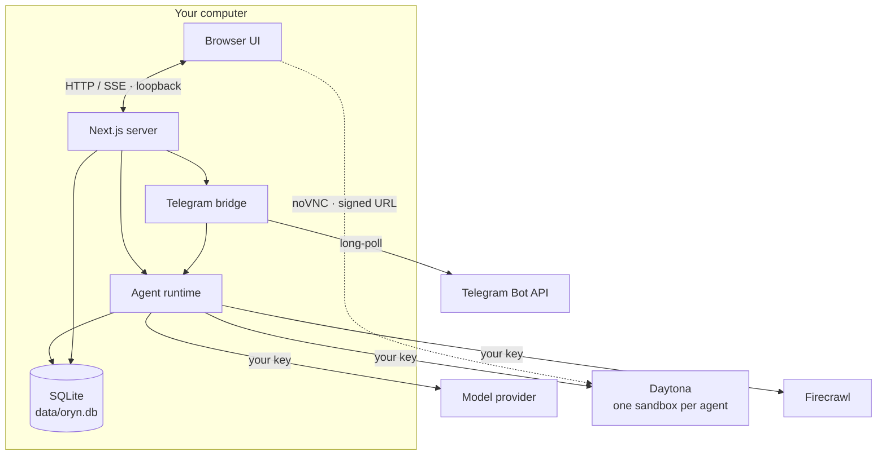

# Architecture

Oryn is one Node.js process — a Next.js 16 server — plus a SQLite file. There is no queue, no worker, no separate backend and nothing of ours in the cloud. This page explains how the pieces fit.

## Request flow of a turn

1. The composer posts the new message to `POST /api/threads/:id/turn`.
2. `lib/agent/runtime.ts` loads the thread (agent or squad), resolves the model (`lib/providers/registry.ts`), saves the user message, and builds the tool belt for the configured capabilities.
3. Instructions are assembled per agent (`lib/agent/instructions.ts`): identity, standing orders, capabilities, **memory notes**, squad roster and channel.
4. `streamText` runs the tool loop. Its output becomes a UI message stream that is **buffered in a run object** and fanned out to any number of subscribers.
5. When the stream ends the reply is persisted, the thread preview updated and a row written to the `turns` ledger.

Because the run lives in the server process and not in the HTTP request, closing the tab doesn't stop it. `GET /api/threads/:id/turn` replays the buffer and follows it live — that's how a reload re-attaches. `DELETE` aborts it.

## Tools

Defined in `lib/agent/tools.ts`. Every tool resolves "the agent holding the turn" at call time, so after a delegation the same tool acts on the new agent's workstation and memory.

| Group | Tools | Backed by |
| --- | --- | --- |
| Workstation | `shell`, `fs_read`, `fs_write`, `fs_list` | Daytona process + filesystem APIs |
| Desktop | `screen_capture`, `screen_share`, `pointer_*`, `key_*` | Daytona computer-use APIs |
| Memory | `memory_write`, `memory_forget` | Local SQLite |
| Web | `web_search`, `web_fetch` | Firecrawl v2 |
| Squad | `delegate` | Runtime (swaps agent, instructions and model) |
| Hand-off | `request_takeover` | Runtime (ends the turn) + Telegram notice |

Screenshots are returned to the model as images. Before every step, `prepareStep` compacts the turn's context: only the two most recent screenshots and the six most recent tool outputs are kept in full, older ones are cut to short stubs. A long desktop session therefore costs roughly the same per step at step 40 as at step 4.

## Take-over and hand-offs

Either side can hand the desktop over.

- **You take over.** The workbench's *Take over* button stops a running turn (the same `DELETE` as *Stop*) and opens the desktop full-size with input enabled. *Hand back* sends an ordinary user message carrying `metadata.handback` with your optional note; the transcript renders it as a divider, and the instructions tell the agent to take a fresh `screen_capture` before doing anything else, since the screen may have changed.
- **The agent hands off.** At a login, payment, one-time code or CAPTCHA the agent calls `request_takeover({ reason })`. `stopWhen` includes `hasToolCall("request_takeover")`, so the turn ends right there. The UI sees the fresh tool call and opens the take-over view; if Telegram is paired, `notifyTakeover` sends the owner the reason, a 30-minute signed noVNC link to that sandbox (usable from a phone) and a deep link to `/a/:agent/:thread?takeover=1`, and points the chat at that thread so the reply continues it.

## Squads and delegation

A squad thread has an ordered list of members. A message is addressed to one of them. When that agent calls `delegate`, the tool switches the runtime's *current agent*; `prepareStep` then swaps the system instructions and the **model** for the next step, so each member thinks with its own model and works on its own workstation. The receiving agent is told who handed over and with what brief. A request can't bounce back to an agent that already held it.

## Workstations

`lib/workstation.ts` provisions a Daytona sandbox the first time an agent needs one and records its id on the agent. Sandboxes stop after `DAYTONA_AUTO_STOP_MINUTES` idle and are woken on demand. With `DAYTONA_AUTO_DELETE_MINUTES` they are destroyed after stopping, and a fresh one is created next time. Deleting or resetting an agent always destroys its sandbox. The live desktop connects the browser directly to the sandbox's noVNC port through a signed, expiring preview URL.

## Data

Everything lives in `data/oryn.db` (override with `ORYN_DATA_DIR`). Schema: `db/schema.ts`; migrations in `db/migrations` run automatically at boot.

| Table | Holds |
| --- | --- |
| `agents` | Name, role, standing orders, model, glyph seed, workstation id |
| `squads`, `squad_members` | Squads and their ordered members |
| `threads`, `messages` | Conversations and their UI messages (JSON parts) |
| `memories` | Long-term notes per agent |
| `turns` | The usage ledger |
| `settings` | Values saved from Settings (override `.env`) |

## Settings resolution

`lib/config.ts` defines every setting once, with its environment variable and default. A value saved in the UI wins over `.env`, which wins over the default. Secrets are only ever described to the browser in masked form.

## Telegram bridge

`lib/telegram/bridge.ts` long-polls `getUpdates` from inside the server process — no inbound connection is needed. Updates are processed per chat in order. Unpaired users get a refusal; the owner's messages start turns through the same runtime with `channel: "telegram"`, progress is reported by editing one status message, and the final reply (including shared screenshots as photos) is sent when the run ends. Threads started from Telegram are ordinary threads in the app.

## Security boundary

`proxy.ts` runs before every request and refuses any `Host` or `Origin` that isn't loopback (or in `ORYN_ALLOWED_HOSTS`). Together with binding to `127.0.0.1`, this keeps an account-less app private and blocks DNS rebinding. See [SECURITY.md](../SECURITY.md).
