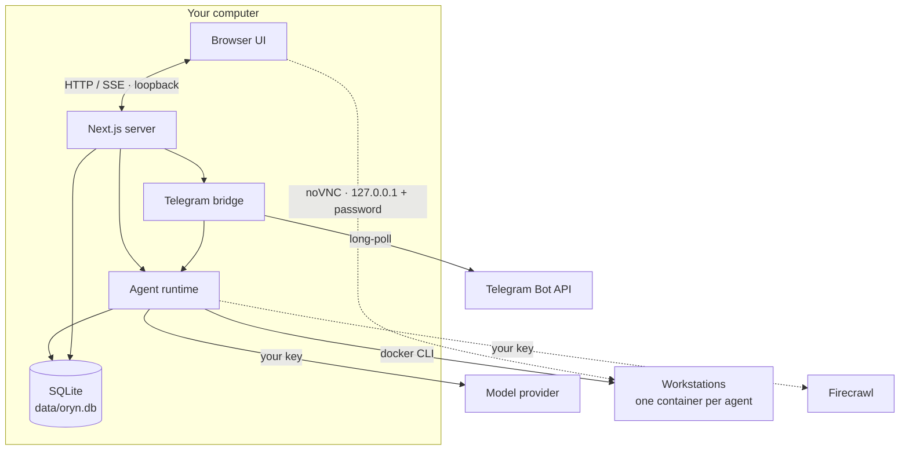

# Architecture

Oryn is one Node.js process — a Next.js 16 server — plus a SQLite file. There is no queue, no worker, no separate backend and nothing of ours in the cloud. This page explains how the pieces fit.

## Request flow of a turn

1. The composer posts the new message to `POST /api/threads/:id/turn`.
2. `lib/agent/runtime.ts` loads the thread (agent or squad), resolves the model (`lib/providers/registry.ts`), saves the user message, and builds the tool belt for the configured capabilities.
3. Instructions are assembled per agent (`lib/agent/instructions.ts`): identity, standing orders, capabilities, **memory notes**, squad roster and channel.
4. `streamText` runs the tool loop. Its output becomes a UI message stream that is **buffered in a run object** and fanned out to any number of subscribers.
5. When the stream ends the reply is persisted, the thread preview updated and a row written to the `turns` ledger.

Because the run lives in the server process and not in the HTTP request, closing the tab doesn't stop it. `GET /api/threads/:id/turn` replays the buffer and follows it live — that's how a reload re-attaches. `DELETE` aborts it.

## Tools

Defined in `lib/agent/tools.ts`. Every tool resolves "the agent holding the turn" at call time, so after a delegation the same tool acts on the new agent's workstation and memory.

| Group | Tools | Backed by |
| --- | --- | --- |
| Workstation | `shell`, `fs_read`, `fs_write`, `fs_list` | `docker exec` into the agent's container |
| Desktop | `screen_capture`, `screen_share`, `pointer_*`, `key_*` | `scrot` and `xdotool` on the container's X display |
| Memory | `memory_write`, `memory_forget` | Local SQLite |
| Web | `web_search`, `web_fetch` | Firecrawl v2 |
| Squad | `delegate` | Runtime (swaps agent, instructions and model) |
| Hand-off | `request_takeover` | Runtime (ends the turn) + Telegram notice |

Screenshots are returned to the model as images. Before every step, `prepareStep` compacts the turn's context: only the two most recent screenshots and the six most recent tool outputs are kept in full, older ones are cut to short stubs. A long desktop session therefore costs roughly the same per step at step 40 as at step 4.

## Take-over and hand-offs

Either side can hand the desktop over.

- **You take over.** The workbench's *Take over* button stops a running turn (the same `DELETE` as *Stop*) and opens the desktop full-size with input enabled. *Hand back* sends an ordinary user message carrying `metadata.handback` with your optional note; the transcript renders it as a divider, and the instructions tell the agent to take a fresh `screen_capture` before doing anything else, since the screen may have changed.
- **The agent hands off.** At a login, payment, one-time code or CAPTCHA the agent calls `request_takeover({ reason })`. `stopWhen` includes `hasToolCall("request_takeover")`, so the turn ends right there. The UI sees the fresh tool call and opens the take-over view; if Telegram is paired, `notifyTakeover` sends the owner the reason, a 30-minute link to that desktop through a Cloudflare quick tunnel (usable from a phone) and a deep link to `/a/:agent/:thread?takeover=1`, and points the chat at that thread so the reply continues it.

## The vault

`lib/vault.ts` stores logins, cards, UPI IDs and personal details in `vault_items`, each sealed with AES-256-GCM (the item's id and kind are bound in as associated data). The key comes from the operating system's keychain — `security` on macOS, DPAPI through PowerShell on Windows, `secret-tool` on Linux — or a `0600` file outside the data folder, and is never recreated while items exist. Agents get four tools:

| Tool | Does |
| --- | --- |
| `vault_list` | Labels and masked hints, never values |
| `vault_fill` | Types one field into the focused input: from stdin through `xdotool`, then `oryn-mask` shows it as dots. Checks the page's site through Chromium's debugging port first: a login only on its own site, a card or UPI ID only with an approval for this thread and site |
| `request_payment_approval` | Records a pending payment (merchant, amount, site) and ends the turn. The person approves with a saved method, takes over, or declines — in the transcript card or with Telegram buttons |
| `request_secret` | Ends the turn with a secure form for a login, card, UPI ID, personal details or a code. What's entered goes straight into the vault; the agent receives the new item's id. On Telegram, a requested code can be replied with; the message is deleted and the code stored once |

Answers continue the thread as ordinary messages that carry ids and hints only (`lib/vault-requests.ts`).

## Notifications

The runtime emits an event when a turn finishes (or fails) and when an agent hands over its screen (`lib/events.ts`). The browser follows them over a server-sent event stream at `/api/events`: the notifier plays a short synthesized chime and shows a desktop notification when Oryn isn't the window in focus, or a toast when you're elsewhere in the app. A finished turn that started in the app is also sent to the paired Telegram account when it took a minute or more (`ORYN_TELEGRAM_NOTIFY`).

## Squads and delegation

A squad thread has an ordered list of members. A message is addressed to one of them. When that agent calls `delegate`, the tool switches the runtime's *current agent*; `prepareStep` then swaps the system instructions and the **model** for the next step, so each member thinks with its own model and works on its own workstation. The receiving agent is told who handed over and with what brief. A request can't bounce back to an agent that already held it.

## Workstations

Each agent's workstation is a Docker container named `oryn-ws-<agent id>`, run from an image built on your computer out of [`workstation/`](../workstation): Debian with Xvfb, xfwm4 and a panel, Chromium, x11vnc + noVNC, xdotool, Node.js, Python and passwordless `sudo`. Oryn talks to Docker only through the `docker` CLI (`lib/docker.ts`), so Docker Desktop, Docker Engine, Colima or OrbStack all work, as does whatever context the CLI points at.

- **Image.** Its tag is a fingerprint of the `workstation/` folder (`lib/workstation-image.ts`). `npm run setup` builds it, or Oryn does at boot or on first use. When an update changes the folder, the new image is built once and each agent moves to it the next time its machine starts.
- **Lifecycle.** The first tool call that needs a machine creates it (starting Docker Desktop if it isn't running), with the agent's home folder in a named volume, `oryn-home-<agent id>`, so files survive restarts and image updates. Inside the container a watchdog stops it after `ORYN_WORKSTATION_AUTO_STOP_MINUTES` without activity (a running command or someone watching counts), even if Oryn itself is closed. A janitor in the server removes machines of deleted agents and, with `ORYN_WORKSTATION_AUTO_DELETE_MINUTES`, machines stopped for longer than that. Resetting or deleting an agent removes its container and volume.
- **Commands.** `shell` runs `oryn-run`, which writes output to a file, so a program left running in the background can't hold the call open, and returns the beginning and end of very long output.
- **Live desktop.** noVNC listens on port 6080 inside the container, published on `127.0.0.1` with a random host port. The browser connects there directly with the container's random VNC password, which only the server hands out. For phone take-overs, `oryn-tunnel` starts a Cloudflare quick tunnel inside the container that closes itself after 30 minutes.

## Data

Everything lives in `data/oryn.db` (override with `ORYN_DATA_DIR`). Schema: `db/schema.ts`; migrations in `db/migrations` run automatically at boot.

| Table | Holds |
| --- | --- |
| `agents` | Name, role, standing orders, model, glyph seed, workstation id |
| `squads`, `squad_members` | Squads and their ordered members |
| `threads`, `messages` | Conversations and their UI messages (JSON parts) |
| `memories` | Long-term notes per agent |
| `turns` | The usage ledger |
| `settings` | Values saved from Settings (override `.env`) |

## Settings resolution

`lib/config.ts` defines every setting once, with its environment variable and default. A value saved in the UI wins over `.env`, which wins over the default. Secrets are only ever described to the browser in masked form.

## Telegram bridge

`lib/telegram/bridge.ts` long-polls `getUpdates` from inside the server process — no inbound connection is needed. Updates are processed per chat in order. Unpaired users get a refusal; the owner's messages start turns through the same runtime with `channel: "telegram"`, progress is reported by editing one status message, and the final reply (including shared screenshots as photos) is sent when the run ends. Threads started from Telegram are ordinary threads in the app.

## Security boundary

`proxy.ts` runs before every request and refuses any `Host` or `Origin` that isn't loopback (or in `ORYN_ALLOWED_HOSTS`). Together with binding to `127.0.0.1`, this keeps an account-less app private and blocks DNS rebinding. See [SECURITY.md](../SECURITY.md).
